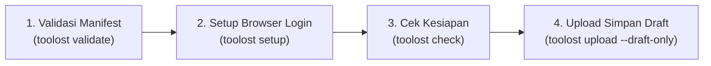

# Toolost Uploader

CLI & Playwright Automation Tool untuk manajemen dan upload draft rilis [Too Lost](https://toolost.com) berbasis manifest JSON.

[](https://pypi.org/project/toolost-uploader/)
[](https://www.python.org/)
[](https://github.com/gunamaya/toolost-uploader/blob/main/LICENSE)
[](#pengujian--pengembangan)

---

## Fitur Utama

- **Validasi Manifest Offline**: Memvalidasi metadata rilis (Single & Album), resolusi artwork (3000×3000px), format audio (MP3/WAV/FLAC), dan kecocokan hash integritas berkas (SHA-256) tanpa membuka jaringan atau browser.
- **Sesi Browser Mandiri & Aman**: Membuka Google Chrome biasa di profil lokal terisolasi (`.local/profiles/<alias>`) agar operator dapat login manual dengan aman tanpa menyimpan password/cookie mentah di kode repo.
- **Auto-Bootup & Readiness Check**: Diagnosa otomatis ketersediaan binary Chrome, status lock profil, port CDP (Chrome DevTools Protocol loopback), dan verifikasi sesi login aktif Too Lost terhadap `--expected-account`.
- **Eksekutor Playwright Single & Multi-Track Album**: Mengotomatisasi pemilihan tipe rilis, pengisian judul, upload & encoding artwork, multi-track audio, penataan urutan track, pengisian metadata AI per-track, hingga eksekusi simpan perubahan (*Save Changes*).
- **Safety First (Draft-Only Guard)**: Eksekusi dibatasi secara ketat hanya sampai penyimpanan draft (`--draft-only`). Tool ini **tidak pernah** menekan tombol Publish atau memicu distribusi rilis.
- **Desain Integrasi Subprocess**: Format keluaran stdout JSON murni yang deterministik dan aliran log progres real-time ke stderr, sangat ramah untuk diintegrasikan dengan aplikasi backend, Textual UI, atau orchestrator rilis musik otomatis.

---

## Instalasi

### Dari PyPI (Rekomendasi)

```sh
pip install toolost-uploader
playwright install chromium
```

### Dari Source / Git

```sh
git clone https://github.com/gunamaya/toolost-uploader.git
cd toolost-uploader
python3 -m venv .venv
source .venv/bin/activate
pip install -e .
playwright install chromium
```

---

## Panduan Penggunaan Cepat

Alur kerja umum terdiri dari 4 langkah berurutan:



### 1. Validasi Manifest Rilis (Offline)

Periksa integritas manifest JSON dan kecocokan hash SHA-256 berkas lokal:

```sh
toolost validate path/to/manifest.json --json
```

### 2. Setup Sesi Browser (Login Manual Operator)

Buka browser Chrome lokal untuk login manual ke portal Too Lost. Sesi login akan disimpan secara privat di folder profil lokal:

```sh
toolost setup --profile production
```
*Tutup jendela Chrome setelah selesai login.*

### 3. Diagnosa Kesiapan Lingkungan (Readiness Check)

Pastikan Google Chrome, port CDP, dan sesi akun siap:

```sh
toolost check --profile production --expected-account 422512 --auto-bootup --json
```

Contoh keluaran JSON (`exit code 0`):
```json
{
  "status": "ready",
  "chrome_binary": "/Applications/Google Chrome.app/Contents/MacOS/Google Chrome",
  "profile_dir": "/path/to/.local/profiles/production",
  "cdp_url": "http://127.0.0.1:9437",
  "auth": {
    "status": "authenticated",
    "account_id": "422512"
  }
}
```

### 4. Unggah & Simpan Draft Rilis

Jalankan otomatisasi upload Playwright. Port CDP akan otomatis di-bootup bila belum aktif:

```sh
toolost upload path/to/manifest.json \
  --draft-only \
  --profile production \
  --expected-account 422512 \
  --approve-draft \
  --accept-ui-date \
  --verbose \
  --json
```

Contoh keluaran JSON sukses:
```json
{
  "status": "draft_saved_subset",
  "run_id": "20261026-154000-album-test",
  "draft_id": "2004317",
  "warnings": [
    "Tanggal UI diwarisi; bukan release_date manifest terverifikasi.",
    "Remote track identity dan rights/services belum diverifikasi; bukan siap distribusi."
  ]
}
```

### 5. Sinkronisasi & Update Draft Existing (`--update` / `--append`)

Jika Anda telah mengunggah draft rilis di Too Lost dan ingin memperbarui data rilis berdasarkan perubahan manifest terbaru:

- **Judul Rilis**: Diperbarui jika `title` di manifest berubah.
- **Tanggal Rilis**: Diperbarui di datepicker Too Lost jika `release_date` di manifest berubah.
- **Cover Artwork**: Diperbarui via tombol *Replace* jika `artwork` di manifest berubah.
- **Metadata Lagu Lama**: Memperbarui judul track, status AI-assisted content, dan lirik jika ada revisi.
- **Tambah Lagu Susulan**: Otomatis mengunggah file audio baru via tombol *Upload* di tab *Manage Tracks* dan mengisi metadatanya jika ada track baru di urutan akhir manifest.

Cukup jalankan perintah `upload` dengan menyertakan flag `--update` (atau `--append`):

```sh
toolost upload path/to/manifest.json \
  --draft-only \
  --update \
  --profile production \
  --expected-account 422512 \
  --approve-draft \
  --accept-ui-date \
  --verbose \
  --json
```

*Catatan: Jika manifest yang dikirimkan identik dengan draft yang tersimpan (tidak ada perubahan), CLI akan langsung melaporkan status `draft_up_to_date` tanpa mengulang proses upload.*

---

## Spesifikasi Manifest JSON (Schema v1)

Contoh manifest untuk rilis Album multi-track:

```json
{
  "schema_version": 1,
  "release_id": "album-project-001",
  "release_type": "album",
  "title": "Album Eksperimental FlowMusic",
  "release_date": "2026-11-01",
  "artwork": {
    "path": "/path/to/artwork-3000x3000.png",
    "sha256": "338ca5ab7fb090dfa5b6cdc8fd6c68f2f8afa939266e412d85ee35187b275de6"
  },
  "tracks": [
    {
      "track_id": "track-01",
      "title": "Terangnya Belum Pulang",
      "audio": {
        "path": "/path/to/track-01.mp3",
        "sha256": "53431441811b965acc69664ec4e2dcf47d5765c2ddc483f4daf49ded30a7214d"
      },
      "ai_assisted": true,
      "lyrics": {
        "path": "/path/to/lyrics-01.txt",
        "sha256": "8f481c0337b51d6c05df4d7c07b0ecfa5742416f4ad16e87c0e68e4a5fb151c8"
      }
    },
    {
      "track_id": "track-02",
      "title": "Sungai Teh Susu",
      "audio": {
        "path": "/path/to/track-02.mp3",
        "sha256": "4278102d0dcc1ba4e1886ba518552c1a974a8f88679536a021b3896eaecf61f1"
      },
      "ai_assisted": true
    }
  ]
}
```

---

## Referensi Kode Keluar (Exit Codes)

| Exit Code | Status JSON | Makna & Tindakan Penanganan |
|---|---|---|
| **`0`** | `valid`, `ready`, `draft_saved_subset` | Eksekusi sukses. Payload JSON memuat informasi rilis / kesiapan. |
| **`2`** | `invalid_input`, `login_required`, `account_mismatch` | Argumen salah, hash aset tidak cocok, atau sesi login perlu diperbarui melalui `toolost setup`. |
| **`4`** | `reconciliation_required` | Operasi dihentikan aman (*fail-stop*). Periksa status browser atau koneksi. Hindari melakukan *retry* buta. |
| **`5`** | Error I/O / OS | File tidak ditemukan atau binary Chrome gagal diluncurkan. |

---

## Pengujian & Pengembangan

Menjalankan seluruh rangkaian tes unit offline (stdlib, tanpa memerlukan login atau koneksi eksternal):

```sh
python3 -m unittest discover -s tests -v
```

Uji sanitasi paket wheel dan instalasi lingkungan terisolasi:

```sh
pip install -e '.[dev]'
uv build
TOOLOST_TEST_DIST_DIR=dist python3 -m unittest tests/test_packaging.py -v
```

Pemeriksaan gaya kode dan whitespace git:

```sh
git diff --check
```

---

## Dokumentasi & Spesifikasi

- [Dokumentasi Rencana Integrasi Subprocess](https://github.com/gunamaya/toolost-uploader/blob/main/docs/INTEGRATION-PLAN.md) — Arsitektur adapter subprocess async & Textual UI.
- [Spesifikasi & Rencana Packaging PyPI](https://github.com/gunamaya/toolost-uploader/blob/main/docs/PACKAGING-PLAN.md) — Roadmap dan checklist sanitasi packaging.
- [Antrean Pekerjaan Utama & Backlog](https://github.com/gunamaya/toolost-uploader/blob/main/docs/ANTRIAN-PEKERJAAN-UTAMA.md) — Pelacakan status task engineering, klaim, dan acceptance.
- [Riwayat Checkpoint Rekayasa](https://github.com/gunamaya/toolost-uploader/blob/main/docs/backlog/CHECKPOINT-HISTORY.md) — Bukti eksekusi dan log verifikasi.
- [Review CLI & Analisis Kontrak](https://github.com/gunamaya/toolost-uploader/blob/main/docs/CLI-REVIEW.md) — Pemetaan fitur yang diimplementasikan vs proposed.

---

## Kebijakan Keamanan & Privasi

1. **Penyimpanan Sesi Lokal**: Folder `.local/` berisi session cookie Chrome privat dan attempt journal tidak pernah di-commit atau dimasukkan ke dalam paket distribusi sdist/wheel.
2. **Tanpa Otomasi Kredensial**: Tool ini tidak membaca password operator, tidak melakukan scraping cookie secara ilegal, dan tidak mencoba melewati CAPTCHA/2FA.
3. **Draft Only**: Operasi rilis dihentikan di level penyimpanan draft untuk ditinjau oleh operator manusia sebelum proses rilis aktual.

---

## Lisensi

Proyek ini didistribusikan di bawah lisensi [MIT License](https://github.com/gunamaya/toolost-uploader/blob/main/LICENSE).
Hak Cipta (c) 2026 Anggi Gunamaya.
