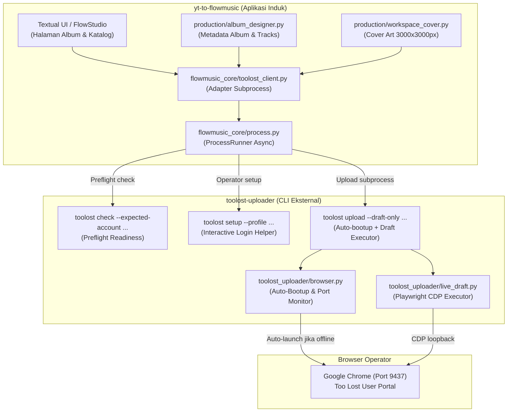

# Rencana Integrasi toolost-uploader ke yt-to-flowmusic

Dokumen spesifikasi arsitektur dan tahapan integrasi antara CLI `toolost-uploader` dan aplikasi induk `yt-to-flowmusic`.

---

## 1. Arsitektur Hubungan Antar-Proyek



- **Pemisahan Tanggung Jawab**:
  - `yt-to-flowmusic`: Bertanggung jawab atas perancangan kreatif album, generasi audio & lirik, pembuatan artwork final, dan persistensi database/workspace.
  - `toolost-uploader`: Bertanggung jawab secara independen dan terisolasi untuk kesiapan browser/autentikasi (`check`, `setup`, auto-bootup CDP), interaksi web Too Lost via Playwright CDP, validasi manifest, fail-stop idempotensi, dan pelaporan status terstruktur.
- **Kopling Longgar (Loose Coupling)**: Integrasi murni melalui **CLI subprocess** dengan manifest JSON file temporer dan hasil stdout JSON deterministik. Tidak ada dependency impor modul langsung antar-repo. Browser Chrome CDP otomatis dinyalakan jika belum aktif.

---

## 2. Kontrak Data (Schema v1)

Modul adapter di `yt-to-flowmusic` mengekspor file manifest sementara (`tmp_manifest.json`) sebelum memanggil CLI:

```json
{
  "schema_version": 1,
  "release_id": "album-project-<uuid>",
  "release_type": "album",
  "title": "<Album Title>",
  "release_date": "YYYY-MM-DD",
  "artwork": {
    "path": "/Users/.../workspace/cover_3000.png",
    "sha256": "338ca5ab7fb090dfa5b6cdc8fd6c68f2f8afa939266e412d85ee35187b275de6"
  },
  "tracks": [
    {
      "track_id": "track-1-<uuid>",
      "title": "<Judul Lagu 1>",
      "audio": {
        "path": "/Users/.../takes/song-1-final.mp3",
        "sha256": "53431441811b965acc69664ec4e2dcf47d5765c2ddc483f4daf49ded30a7214d"
      },
      "ai_assisted": true
    },
    {
      "track_id": "track-2-<uuid>",
      "title": "<Judul Lagu 2>",
      "audio": {
        "path": "/Users/.../takes/song-2-final.mp3",
        "sha256": "4278102d0dcc1ba4e1886ba518552c1a974a8f88679536a021b3896eaecf61f1"
      },
      "ai_assisted": true
    }
  ]
}
```

---

## 3. Spesifikasi Pemanggilan CLI Subprocess

### 3.1. Preflight Readiness (`toolost check`)

Sebelum memulai alur upload, `yt-to-flowmusic` dapat memeriksa kesiapan environment tanpa membuka form uploader:

```sh
toolost check \
  --profile <profile_alias> \
  --expected-account <account_id> \
  --auto-bootup \
  --json
```

- **Exit Code 0 (`status: "ready"`)**: Chrome terpasang, port CDP aktif (atau berhasil di-bootup otomatis), dan sesi login cocok dengan `--expected-account`.
- **Exit Code 2 (`status: "login_required"` / mismatch)**: Pengguna belum login atau akun berbeda. UI menampilkan tombol untuk membuka `toolost setup`.
- **Exit Code 5**: Binary Chrome tidak ditemukan.

### 3.2. Setup Browser Login Manual (`toolost setup`)

Jika status akun belum terautentikasi:

```sh
toolost setup --profile <profile_alias>
```
Membuka browser Chrome reguler agar operator login manual dan menyimpan cookie sesi di folder profil lokal.

### 3.3. Eksekutor Upload Draft (`toolost upload`)

Adapter memanggil CLI dengan argumen standar (auto-bootup CDP aktif secara otomatis jika port belum mendengarkan):

```sh
toolost upload <path_to_tmp_manifest.json> \
  --draft-only \
  --profile <profile_alias> \
  --expected-account <account_id> \
  --cdp http://127.0.0.1:9437 \
  --approve-draft \
  --accept-ui-date \
  --verbose \
  --json
```

### Penanganan Exit Code & Output

| Exit Code | Makna | Respons di `yt-to-flowmusic` |
|---|---|---|
| **`0`** | Sukses (`draft_saved_subset`) | Ambil `draft_id` dari payload JSON; simpan ke metadata album di database; tampilkan notifikasi sukses dengan link ke uploader. |
| **`2`** | Invalid input / manifest | Tampilkan pesan error validasi (misal hash aset tidak cocok, format belum persegi 3000x3000px). |
| **`4`** | Reconciliation required | Operasi dihentikan aman (fail-stop); beri tahu operator untuk memeriksa status browser atau login ulang manual. Jangan retry buta. |
| **`5`** | OS / Process Error | Terjadi kegagalan I/O atau binary tidak ditemukan. |

---

## 4. Rincian Implementasi di `yt-to-flowmusic`

### 4.1. File Baru: `flowmusic_core/toolost_client.py`

Menyediakan:
1. `export_toolost_manifest(album_design, workspace_dir) -> Path`:
   - Mengambil data album dari `AlbumDesign`.
   - Mengambil path artwork dari `workspace_cover` dan menghitung SHA-256.
   - Mengambil daftar track yang sudah berstatus *ready/mastered*, menghitung SHA-256 berkas audionya, dan menandai `ai_assisted: True`.
   - Menulis file manifest sementara berizin `0o600`.
2. `class TooLostClient`:
   - Mewarisi atau menggunakan `ProcessRunner` async dari `flowmusic_core/process.py`.
   - Mendeteksi letak executable `toolost` (menggunakan path binary konfigurasi atau virtualenv lokal / PATH).
   - Method async `check_readiness(...) -> dict`: Mengecek status login dan auto-bootup CDP sebelum proses upload.
   - Method async `launch_setup(...) -> int`: Membantu operator membuka Chrome untuk login manual jika sesi kedaluwarsa.
   - Method async `upload_album_draft(...) -> dict`: Menjalankan subprocess upload, menangani stream progres stderr untuk update loading bar Textual UI, dan mengembalikan hasil parsed JSON.

### 4.2. File Baru: Settings / Config di `flowmusic_core/config.py` atau `settings.py`

Menyimpan konfigurasi operator Too Lost (disimpan privat di config user, bukan di git):
- `toolost_binary_path`: Path ke binary `toolost` (default auto-detect di PATH atau direktori proyek tetangga).
- `toolost_expected_account`: User ID Too Lost yang sudah direview (misal `422512`).
- `toolost_profile_alias`: Alias profil lokal (misal `flowstudio-production`).
- `toolost_cdp_endpoint`: Loopback CDP port (default `http://127.0.0.1:9437`).

### 4.3. Penambahan Aksi di UI FlowStudio

- Pada layar **Album Designer** atau **Catalog**:
  - Indikator status: Menampilkan dot hijau/merah status kesiapan Too Lost (`toolost check`).
  - Tombol aksi: `[ Upload Draft ke Too Lost ]`.
  - State indikator: Menampilkan dialog progress bar dengan log stream dari stderr CLI (`[toolost] ...`).
  - Setelah selesai exit 0:
    - Muncul toast/banner: `"Draft rilis berhasil disimpan di Too Lost! (Draft ID: #2004317)"`.
    - Tombol `"Buka di Browser"` yang langsung mengarah ke `https://toolost.com/uploader/edit/<draft_id>`.

---

## 5. Tahapan Eksekusi Bertahap (Roadmap)

1. **Tahap 1: Generator Manifest & Pengujian Unit**  
   Implementasi fungsi `export_toolost_manifest` di `yt-to-flowmusic` beserta unit test offline komprehensif yang menguji validasi struktur JSON dan SHA-256 file lokal.

2. **Tahap 2: Klien Subprocess & Mock Tests**  
   Implementasi `TooLostClient` menggunakan `ProcessRunner`, menguji parsing JSON, timeout, error handling exit code 2/4/5, dan streaming stderr log.

3. **Tahap 3: Integrasi Antarmuka Pengguna (Textual UI)**  
   Memasang tombol aksi di tampilan Album FlowStudio dengan modal dialog progresif.

4. **Tahap 4: End-to-End Verification**  
   Pengujian integrasi langsung dari satu album di FlowStudio ke browser CDP yang terhubung ke Too Lost.
