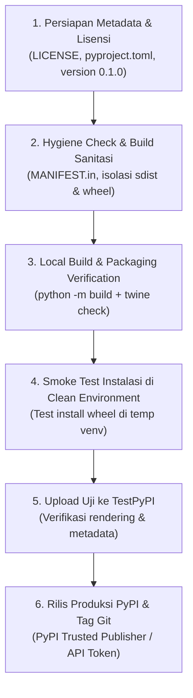

# Rencana Packaging & Distribusi PyPI (toolost-uploader)

Dokumen rencana dan checklist komprehensif untuk memaketkan dan mendistribusikan `toolost-uploader` ke Python Package Index (PyPI).

---

## 1. Tujuan & Sasaran

1. **Distribusi Mudah**: Memungkinkan pengguna dan integrator (seperti `yt-to-flowmusic`) memasang paket dengan:
   ```sh
   pip install toolost-uploader
   playwright install chromium
   ```
2. **Pembersihan Gate Privat**: Menghapus classifier pembatas `Private :: Do Not Upload` secara aman setelah semua metadata, lisensi, dan hygiene verifikasi terpenuhi.
3. **Kebersihan Distribusi**: Memastikan berkas sdist (`.tar.gz`) dan wheel (`.whl`) murni hanya memuat kode paket `toolost_uploader`, **tanpa** menyertakan direktori privat `.local/`, session/kredensial, fixture riset, atau test run artifacts.

---

## 2. Analisis Audit Saat Ini

| Komponen | Status Saat Ini | Target Perubahan untuk PyPI |
|---|---|---|
| **Package Name** | `toolost-uploader` | Tetap `toolost-uploader` (cek ketersediaan nama di PyPI) |
| **Version** | `0.1.0a0` di `__init__.py` | Update ke `0.1.0` (rilis perdana) |
| **Classifier** | Memuat `"Private :: Do Not Upload"` | **Hapus** classifier ini agar `twine upload` tidak menolak |
| **License** | Belum dideklarasikan di pyproject / file LICENSE belum ada | Buat file `LICENSE` (misal MIT) dan deklarasikan di `[project]` |
| **Dependencies** | `dependencies = []` (playwright di optional `[browser]`) | Pindahkan `playwright>=1.40.0,<2` ke core `dependencies` agar instalasi langsung siap pakai |
| **Project URLs** | Belum ada | Tambahkan `Homepage`, `Repository`, `Issues`, `Documentation` |
| **Authors & Keywords** | Belum ada | Tambahkan metadata `authors` dan `keywords` |
| **Include Package Data** | `include-package-data = false` | Pertahankan `false` agar data non-kode di luar package tidak ikut terbawa |
| **Exclusion Rules** | Belum ada `MANIFEST.in` eksplisit | Tambahkan `MANIFEST.in` untuk prune direktori `.local`, `docs`, `tests`, dll dari sdist jika diinginkan, atau konfigurasi setuptools |

---

## 3. Rancangan Pembaruan `pyproject.toml`

```toml
[build-system]
requires = ["setuptools>=77.0.3", "wheel"]
build-backend = "setuptools.build_meta"

[project]
name = "toolost-uploader"
dynamic = ["version"]
description = "CLI and Playwright automation tool for Too Lost release manifests"
readme = "README.md"
requires-python = ">=3.10"
license = { text = "MIT" }
authors = [
    { name = "Gunamaya", email = "developer@kiriminaja.com" }
]
keywords = ["too-lost", "music-distribution", "uploader", "playwright", "automation"]
classifiers = [
    "Development Status :: 4 - Beta",
    "Intended Audience :: Developers",
    "License :: OSI Approved :: MIT License",
    "Programming Language :: Python :: 3",
    "Programming Language :: Python :: 3.10",
    "Programming Language :: Python :: 3.11",
    "Programming Language :: Python :: 3.12",
    "Topic :: Multimedia :: Sound/Audio",
]
dependencies = [
    "playwright>=1.40.0,<2",
]

[project.optional-dependencies]
dev = [
    "build>=1.2.2,<2",
    "twine>=5.0.0,<6",
    "jsonschema>=4.26,<5",
]

[project.urls]
Homepage = "https://github.com/gunamaya/toolost-uploader"
Repository = "https://github.com/gunamaya/toolost-uploader"
Issues = "https://github.com/gunamaya/toolost-uploader/issues"

[project.scripts]
toolost = "toolost_uploader.cli:main"

[tool.setuptools]
packages = ["toolost_uploader"]
include-package-data = false

[tool.setuptools.dynamic]
version = {attr = "toolost_uploader.__version__"}
```

---

## 4. Rencana Tahapan Eksekusi (Roadmap Packaging)



### Tahap 1: Persiapan Lisensi & Metadata
1. Buat file `LICENSE` (MIT License).
2. Perbarui `pyproject.toml` dengan metadata lengkap (authors, license, keywords, urls, dependencies).
3. Update `toolost_uploader/__init__.py` dari `0.1.0a0` ke `0.1.0`.

### Tahap 2: Sanitasi Isi Paket (Build Hygiene)
1. Buat file `MANIFEST.in` untuk memastikan berkas internal berikut **DITOLAK** dari sdist:
   ```text
   prune .local
   prune docs
   prune tests
   exclude .gitignore
   ```
2. Pastikan file `toolost_uploader/` hanya berisi modul Python yang relevan.

### Tahap 3: Build & Validasi Twine
1. Jalankan build:
   ```sh
   python3 -m build
   ```
2. Validasi integritas paket dan rendering markdown README:
   ```sh
   twine check dist/*
   ```
3. Bedah isi berkas archive:
   ```sh
   tar -ztvf dist/toolost_uploader-0.1.0.tar.gz
   unzip -l dist/toolost_uploader-0.1.0-py3-none-any.whl
   ```
   *Verifikasi*: Pastikan tidak ada berkas privat `.local/`, data testing, atau kredensial yang ikut masuk.

### Tahap 4: Pengujian Instalasi Lingkungan Bersih (Clean Venv)
1. Buat virtual environment sementara terisolasi:
   ```sh
   python3 -m venv /tmp/test-toolost-env
   /tmp/test-toolost-env/bin/pip install dist/toolost_uploader-0.1.0-py3-none-any.whl
   ```
2. Verifikasi ketersediaan perintah CLI:
   ```sh
   /tmp/test-toolost-env/bin/toolost --version
   /tmp/test-toolost-env/bin/toolost --help
   /tmp/test-toolost-env/bin/toolost validate --help
   /tmp/test-toolost-env/bin/toolost check --help
   ```

### Tahap 5: Publikasi ke TestPyPI (Dry-Run)
1. Unggah ke TestPyPI:
   ```sh
   twine upload --repository testpypi dist/*
   ```
2. Buka `https://test.pypi.org/project/toolost-uploader/` dan periksa:
   - Tampilan README.md dan format badge/link.
   - Metadata lisensi dan dependencies.
3. Coba pasang dari TestPyPI di environment baru:
   ```sh
   pip install --index-url https://test.pypi.org/simple/ --extra-index-url https://pypi.org/simple/ toolost-uploader
   ```

### Tahap 6: Publikasi Resmi ke PyPI Produksi
1. Pastikan izin rilis publik telah disetujui pengguna secara eksplisit.
2. Buat git commit rilis dan git tag:
   ```sh
   git tag -a v0.1.0 -m "Release version 0.1.0"
   git push origin main --tags
   ```
3. Publikasikan ke PyPI:
   ```sh
   twine upload dist/*
   ```
   *(Atau melalui GitHub Actions Workflow menggunakan PyPI Trusted Publishing / OIDC)*.
4. Pasang dan verifikasi instalasi akhir:
   ```sh
   pip install toolost-uploader
   toolost --version
   ```

---

## 5. Ringkasan Tindakan & Izin yang Dibutuhkan

- [x] Rencana packaging disusun (`docs/PACKAGING-PLAN.md`).
- [ ] Task `PKG-01` didaftarkan ke antrean kanonikal `docs/ANTRIAN-PEKERJAAN-UTAMA.md`.
- [ ] Menunggu izin pengguna untuk:
  1. Menghapus classifier `Private :: Do Not Upload`.
  2. Menentukan pemegang hak cipta pada lisensi `LICENSE`.
  3. Menjalankan upload ke TestPyPI / PyPI produksi.
